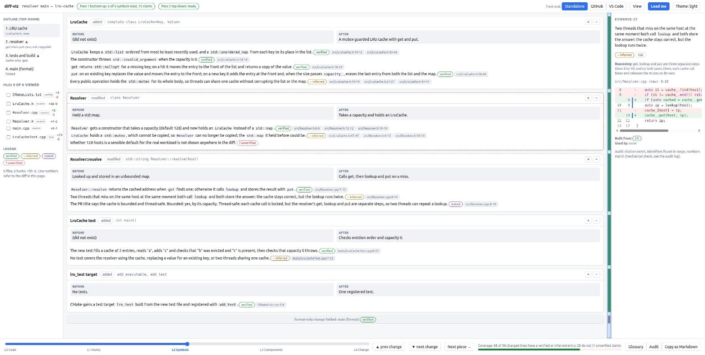
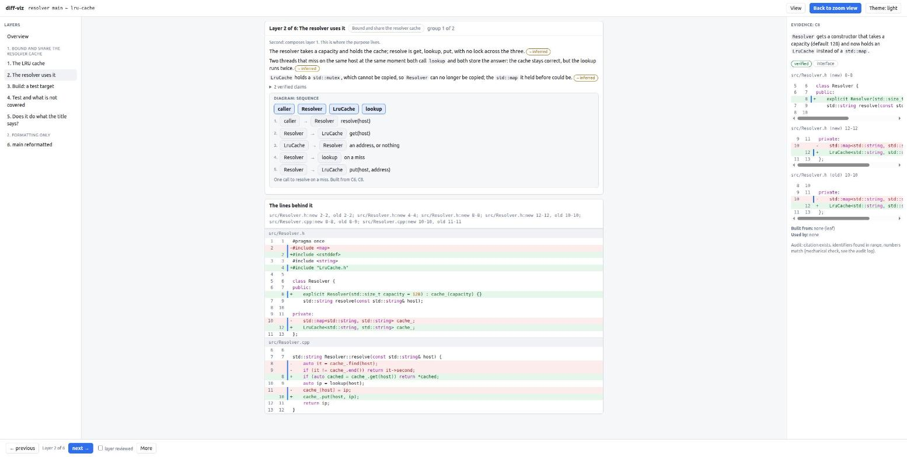
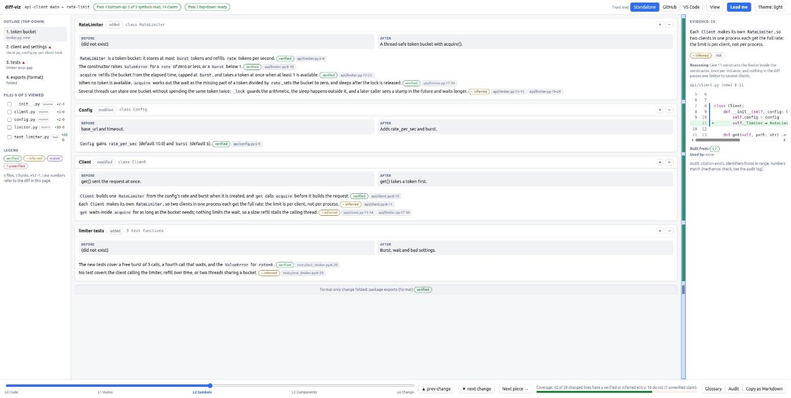
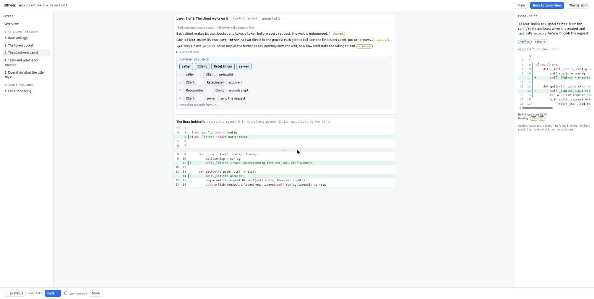
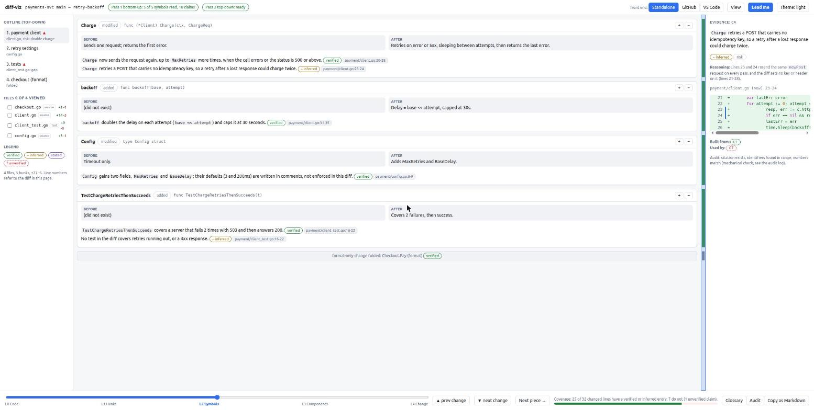
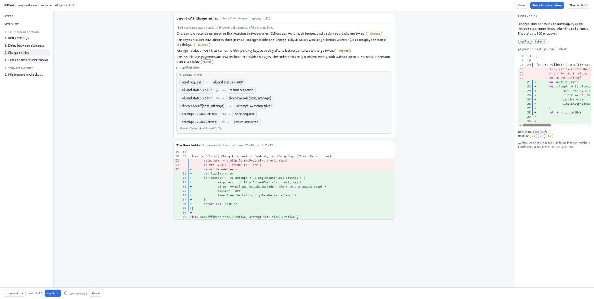

# explainThis

A Claude Code skill that explains a large subsystem or module top-down, piece by piece. Each piece is reviewed bottom-up
first, so every statement in the explanation is backed by code that was actually read. After each piece it stops and waits
for your follow-up questions.

## Skill

`.claude/skills/explain-this/SKILL.md`

How it works:

1. Maps the subsystem and proposes an ordered list of pieces.
2. For each piece, reviews the code from the leaves upward before writing anything.
3. Presents the piece top-down, with a `file:line` reference on every claim, labelled verified, inferred or unverified.
4. Re-checks each citation against the code before sending.
5. Stops and waits for follow-up questions or "next".

It is read-only and never edits the code it explains.

## Use

Open Claude Code in this repo, or copy `.claude/skills/explain-this` to `~/.claude/skills/` to use it anywhere, then ask:

```
/explain-this internal/auth
```

## Way Beyond Compare

A side-by-side diff shows what changed. It does not say what the change does, which parts depend on which, or what nobody checked.
`diff-viz` turns a diff into a page that does: a slider from raw code up to one overview, and a guided "Lead me" walkthrough that
groups the changes by meaning and shows one at a time. Every sentence on the page carries a label (verified, inferred, stated or
unverified) and cites the lines it rests on, and a script checks those citations before the page is built. Light and dark themes.

The pages below are built by the `diff-mock` skill (`.claude/skills/diff-mock/`) from small artificial changes, one per language.
The code is made up: the C++ change compiles and its test passes, the Python tests pass (4 passed), and the Go change is a
fragment that is not meant to build. Each page passed the checks (0 errors). Open any `mock.html` in a browser;
the diff and the ledger of claims sit beside it. Spec: `diff-viz/REQUIREMENTS.md`.

To make one for your own change, ask Claude Code in this repo: `/diff-mock` and name a commit, a range, a patch file or a file of code.

### C++ Edition

A resolver cache that grew without limit is replaced by a mutex-guarded LRU cache (`diff-viz/gallery/cpp/`, 6 files, +90 -6).
The page finds a race the title does not mention (get, lookup and put are three separate locked steps, so two threads can repeat
a lookup) and a side effect (the mutex makes `Resolver` non-copyable), and it folds a pure reformat of `main.cpp`.

Zoom view, symbols level, with the evidence for one inferred claim:



Lead me, layer 2 of 6, with a sequence diagram built from the cited lines:



### Python Edition

A token-bucket rate limiter is added to an API client (`diff-viz/gallery/python/`, 5 files, +57 -1). The page notes that each client
makes its own bucket (the limit is per client, not per process), that the wait is unbounded, and that the PR title's promise to
stop rate-limit errors is more than the code does. The tests cover the bucket alone, and the page says so.





### Go Edition

A payment client retries failed charges with a capped, doubling delay (`diff-viz/gallery/go/`, 4 files, +27 -5). The page flags that
the retried POST carries no idempotency key, marks the provider's behaviour as unverified (it is not in the repository), and shows the
retry loop as a flow diagram.




